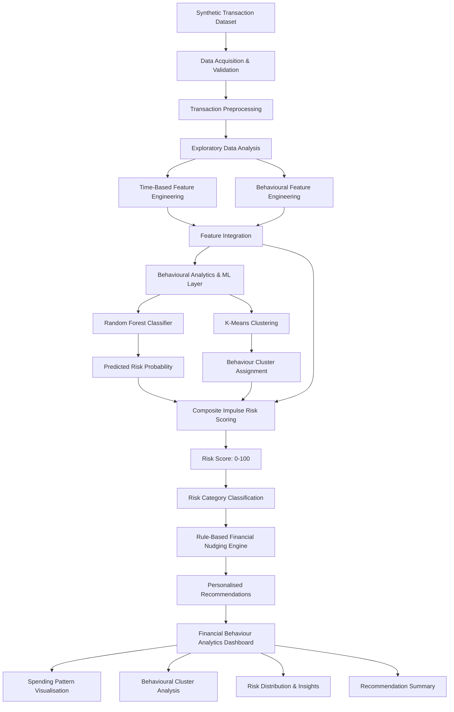
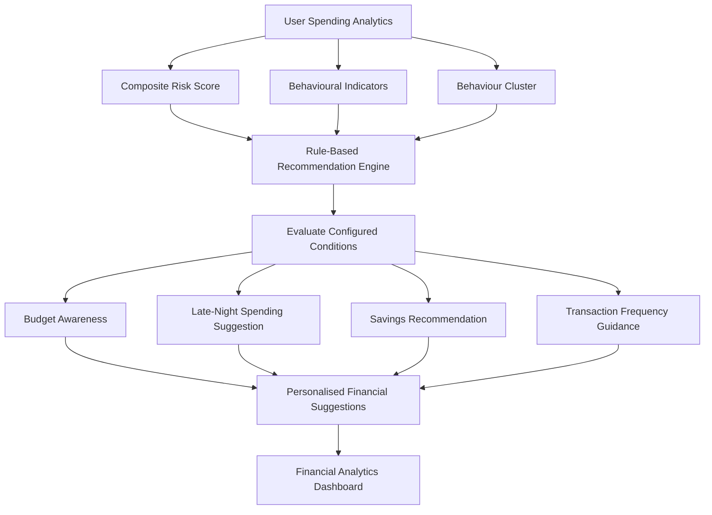

# OrgX – Online Hackathon

## AI-Driven Impulsive Spending Risk Detection System

An AI-powered financial behaviour analytics system that combines machine learning, behavioural pattern analysis, and personalised financial nudging to identify potential impulsive spending tendencies among young adults. The system analyses transaction-level spending behaviour, extracts time-based and behavioural features, applies Random Forest classification and K-Means clustering, and generates a composite impulse risk score. A rule-based recommendation engine translates the analytical results into personalised financial suggestions designed to encourage healthier spending habits.

> **Data Disclaimer:** This project uses a synthetically generated transaction-level dataset. The simulated spending patterns and analytical findings do not represent actual banking transactions or validated behavioural-finance research. Model outputs are educational indicators, not clinical, psychological, or financial diagnoses.

---

## Project Overview

Impulsive spending can be influenced by several behavioural and contextual factors, including purchase frequency, transaction timing, spending patterns, and changes in monthly expenditure.

Young adults may experience difficulty maintaining consistent budgets when purchases are driven by convenience, emotional decisions, promotional activity, or unplanned spending.

This project explores how machine learning and behavioural analytics can be used to:

- Identify potentially impulsive spending patterns.
- Analyse transaction timing and spending frequency.
- Estimate potential spending risk.
- Discover behavioural spending profiles.
- Generate personalised financial recommendations.
- Encourage awareness of budgeting and savings habits.

The proposed system combines predictive analytics with an interpretable rule-based recommendation mechanism.

## Problem Statement

Traditional personal expense tracking primarily focuses on recording and categorising transactions. However, transaction records can also reveal behavioural patterns that may help users understand their spending habits.

This project addresses the challenge of identifying potential impulsive spending tendencies by analysing:

- Frequent unplanned purchases.
- Late-night transaction activity.
- Spending concentration towards the end of the month.
- Higher spending in selected consumer categories.
- Variations in transaction frequency.
- Individual spending patterns.

The objective is to develop a machine-learning-based analytics framework that estimates spending risk and provides practical, behaviour-oriented financial suggestions.

## Project Objectives

- Generate a structured synthetic transaction dataset.
- Perform exploratory analysis of consumer spending behaviour.
- Engineer time-based and behavioural transaction features.
- Develop a Random Forest classification model for spending-risk estimation.
- Apply K-Means clustering to discover spending behaviour profiles.
- Develop a composite impulse risk score between 0 and 100.
- Implement a rule-based personalised financial nudging engine.
- Visualise spending patterns, risk levels, and behavioural clusters.
- Demonstrate how predictive analytics can support financial awareness.

## Key Features

- **Synthetic Transaction Generation:** Creates reproducible transaction records with simulated consumer spending patterns.
- **Exploratory Data Analysis:** Examines transaction amounts, spending categories, time patterns, and user-level behaviour.
- **Time-Based Feature Engineering:** Extracts transaction hour, day, month, weekend, late-night, and end-of-month indicators.
- **Behavioural Analytics:** Calculates impulse spending ratio, average spending, and transaction frequency volatility.
- **Random Forest Classification:** Estimates the probability of high-risk impulsive spending based on the configured target.
- **K-Means Clustering:** Groups users into behavioural spending profiles.
- **Composite Risk Scoring:** Combines behavioural indicators and predicted risk probability into a score from 0 to 100.
- **Personalised Financial Nudging:** Generates rule-based suggestions based on selected spending patterns and risk indicators.
- **Visual Analytics:** Presents spending trends, behavioural clusters, and risk distributions.
- **Interactive Exploration:** Supports analysis of individual and aggregate spending behaviour.

---

## System Architecture

The system follows a modular behavioural-finance analytics architecture that transforms transaction-level records into spending insights, predictive risk estimates, behavioural segments, and personalised recommendations.

The architecture is organised into eight major layers:

1. Transaction Data Generation and Acquisition
2. Data Validation and Exploratory Analysis
3. Time-Based and Behavioural Feature Engineering
4. Predictive Risk Classification
5. Behavioural Clustering
6. Composite Impulse Risk Scoring
7. Personalised Financial Nudging
8. Visualisation and Analytical Reporting

### 1. Overall System Architecture



### 2. Architecture Components

| Architecture Layer | Components | Responsibility |
|---|---|---|
| Data Generation | Synthetic transaction generator | Creates simulated transaction-level records. |
| Data Validation | Schema and consistency checks | Validates transaction fields and data quality. |
| Preprocessing | Cleaning and transformation | Prepares records for analytical processing. |
| Exploratory Analysis | Statistical summaries and visualisations | Examines spending patterns and distributions. |
| Feature Engineering | Time-based and behavioural features | Extracts indicators of transaction behaviour. |
| Predictive Analytics | Random Forest Classifier | Estimates the model-defined spending-risk probability. |
| Behavioural Segmentation | K-Means Clustering | Groups users based on selected spending features. |
| Risk Scoring | Weighted composite scoring | Combines behavioural indicators and model output. |
| Recommendation Engine | Configurable business rules | Generates spending-awareness suggestions. |
| Presentation | Dashboard and visualisations | Communicates analytical findings and recommendations. |

### 3. Detailed Data Processing Architecture

**Stage 1 — Transaction Data Generation**

The project uses a synthetic transaction-level dataset generated using predefined behavioural assumptions.

The data-generation process simulates:

- Individual user identifiers.
- Transaction amounts.
- Transaction categories.
- Transaction timestamps.
- Spending frequency.
- Late-night purchase activity.
- End-of-month spending variations.

The synthetic data provides a controlled environment for testing analytical workflows without using confidential banking information.

**Stage 2 — Data Preprocessing**

The transaction records are prepared for analysis through:

- Missing-value checks.
- Data-type validation.
- Timestamp conversion.
- Duplicate transaction checks.
- User-level grouping.
- Transaction amount validation.
- Category standardisation.

**Stage 3 — Exploratory Data Analysis**

Exploratory analysis investigates how simulated spending behaviour varies across users and transaction categories.

Potential analyses include:

- Transaction amount distributions.
- Spending by category.
- Daily and monthly expenditure.
- Hourly transaction patterns.
- Late-night transaction distribution.
- End-of-month spending behaviour.
- User-wise transaction frequency.
- Spending variability.

**Stage 4 — Feature Engineering**

Raw transaction records are transformed into time-based and behavioural features.

The feature engineering process is divided into three groups.

### A. Time-Based Features

| Feature | Description |
|---|---|
| Month | Month of the transaction. |
| Day | Day of the month. |
| Hour | Transaction hour. |
| Day of Week | Day on which the transaction occurred. |
| Late-Night Indicator | Identifies transactions within the configured late-night period. |
| End-of-Month Indicator | Identifies transactions from the 25th onwards. |
| Weekend Indicator | Identifies transactions occurring on weekends. |

### B. Behavioural Features

| Feature | Description |
|---|---|
| Impulse Category Indicator | Identifies transactions in configured categories associated with discretionary spending. |
| Impulse Spending Ratio | Proportion of expenditure attributed to selected impulse categories. |
| Average Spending per User | Average transaction amount for each user. |
| Spending Frequency Volatility | Measures variation in transaction frequency over defined periods. |
| Late-Night Spending Ratio | Proportion of transactions or expenditure occurring during late-night hours. |
| End-of-Month Spending Ratio | Proportion of transactions or expenditure occurring towards month-end. |

These indicators represent constructed behavioural proxies rather than direct measurements of psychological impulsivity.

### C. Model-Derived Features

| Feature | Description |
|---|---|
| Predicted Risk Probability | Random Forest model-estimated probability for the configured high-risk class. |
| Behaviour Cluster Label | K-Means assigned behavioural segment. |
| Composite Impulse Risk Score | Weighted score calculated from selected behavioural indicators and predicted risk probability. |

Model-derived features should be generated only after the relevant models have been trained and validated. They should not be used to construct the training target in a way that introduces circularity or data leakage.

**Stage 5 — Predictive Risk Classification**

The Random Forest Classifier estimates the probability of high-risk spending behaviour.

Its input features can include:

- Impulse spending ratio.
- Late-night spending ratio.
- Spending frequency volatility.
- Average spending.
- Transaction timing indicators.
- Other validated behavioural features.

Output:

- Predicted spending-risk class.
- Model-estimated high-risk probability.
- User-level risk estimates.

The target must be explicitly defined. If the high-risk label is generated using synthetic rules, model performance measures how well the model reproduces those rules, not how accurately it identifies real-world impulsive behaviour.

**Stage 6 — Behavioural Clustering**

K-Means clustering groups users based on their selected spending characteristics.

The demonstration identifies four illustrative profiles:

- Conservative Planner
- Impulsive Night-Owl
- High-Frequency Shopper
- Stable Balanced

Clustering is based on feature similarity. Cluster labels should be assigned after inspecting cluster characteristics and should not automatically be interpreted as psychological or financial identities.

**Stage 7 — Composite Impulse Risk Scoring**

The composite risk scoring mechanism combines selected behavioural indicators with the Random Forest model's predicted risk probability.

The purpose is to create an interpretable score on a 0–100 scale.

**Stage 8 — Personalised Financial Nudging**

A configurable rule-based recommendation engine uses risk indicators and spending patterns to generate practical financial suggestions.

Example interventions include budget awareness messages, spending-limit suggestions, and savings reminders.

**Stage 9 — Dashboard and Reporting**

The analytical results are presented through visualisations and summaries covering:

- Transaction patterns.
- Spending categories.
- User-level behaviour.
- Behavioural clusters.
- Composite risk scores.
- Risk distributions.
- Personalised recommendations.

---

## Dataset Information

<badge color="info">Synthetic Dataset</badge>

**Dataset Type:** Synthetic transaction-level consumer spending data.

Real financial transaction data is often restricted due to privacy, confidentiality, and security requirements. Therefore, this project uses simulated records generated from predefined spending assumptions.

### Data Generation Approach

The synthetic dataset is generated using assumptions designed to create different spending patterns.

| Data Generation Rule | Description |
|---|---|
| Spending Amounts | Normal distributions and configured constraints simulate transaction amounts. |
| Impulse Categories | Higher probabilities are assigned to selected categories such as entertainment, shopping, travel, and food delivery. |
| Late-Night Activity | Increased transaction probability is simulated between 10 PM and 4 AM. |
| Month-End Activity | Additional spending intensity is introduced from the 25th onwards. |
| User Behaviour | Different transaction frequencies and spending characteristics are simulated across users. |

These are synthetic generation assumptions, not empirically established behavioural relationships.

### Suggested Dataset Schema

| Column | Description |
|---|---|
| `user_id` | Synthetic user identifier. |
| `transaction_id` | Synthetic transaction identifier. |
| `timestamp` | Transaction date and time. |
| `amount` | Transaction amount. |
| `category` | Transaction spending category. |
| `day` | Day of the month. |
| `hour` | Transaction hour. |
| `day_of_week` | Day of the week. |
| `is_weekend` | Weekend indicator. |
| `is_late_night` | Late-night indicator. |
| `is_end_of_month` | End-of-month indicator. |
| `is_impulse_category` | Configured category indicator. |

*The schema is illustrative. Retain only columns generated by the actual data-generation implementation.*

---

## Machine Learning Methodology

### 1. Random Forest Classifier

<badge color="success">Supervised Learning</badge>

Random Forest is used to estimate the probability of high-risk impulsive spending behaviour.

The algorithm combines multiple decision trees to model relationships between transaction and behavioural features.

**Key capabilities:**

- Captures nonlinear feature relationships.
- Handles multiple numerical and encoded categorical features.
- Supports probability estimation through `predict_proba` when configured appropriately.
- Provides model-based feature importance measures.

**Model output:**

- Predicted risk class.
- High-risk probability.
- Input for composite impulse risk scoring.

**Composite score contribution:** 40%.

The actual predictive usefulness depends on how the target is defined and how the model is evaluated.

### 2. K-Means Clustering

<badge color="info">Unsupervised Learning</badge>

K-Means groups users according to similarities in selected spending features.

**Illustrative behavioural profiles:**

| Cluster Profile | General Pattern |
|---|---|
| Conservative Planner | Lower and more consistent discretionary spending in the simulated data. |
| Impulsive Night-Owl | Higher proportion of simulated late-night purchases. |
| High-Frequency Shopper | More frequent transactions in the simulated data. |
| Stable Balanced | More consistent spending patterns across selected features. |

The clustering workflow involves:

1. Selecting user-level behavioural features.
2. Handling missing values.
3. Scaling numerical features.
4. Choosing the number of clusters.
5. Fitting the K-Means model.
6. Examining cluster characteristics.
7. Assigning descriptive labels based on observed cluster profiles.

Cluster labels are interpretive descriptions, not validated personality classifications.

---

## Composite Impulse Risk Scoring

The system combines behavioural indicators and the Random Forest predicted probability into a composite score between 0 and 100.

### Risk Score Formula

The conceptual weighted formula is:

\[
RiskScore=100\times(
0.30I+
0.20L+
0.10F+
0.40P
)
\]

Where:

- \(I\) = Normalised impulse spending ratio.
- \(L\) = Normalised late-night spending ratio.
- \(F\) = Normalised spending frequency volatility.
- \(P\) = Random Forest predicted high-risk probability.

Each input is normalised to the range 0–1 before calculation.

| Component | Weight | Description |
|---|---:|---|
| Impulse Spending Ratio | 30% | Contribution from configured impulse-category expenditure. |
| Late-Night Spending Ratio | 20% | Contribution from late-night spending behaviour. |
| Frequency Volatility | 10% | Contribution from transaction-frequency variation. |
| Predicted Risk Probability | 40% | Contribution from Random Forest model output. |
| **Total** | **100%** | **Composite impulse risk score.** |

### Illustrative Risk Categories

| Risk Score | Category |
|---|---|
| 0–39 | Low |
| 40–74 | Moderate |
| 75–100 | High |

These thresholds are illustrative project settings and should not be interpreted as validated financial-risk standards.

The final score is a constructed behavioural indicator, not a clinical measure, credit score, or probability of financial distress.

---

## Personalised Financial Nudging System

The recommendation engine converts spending analytics into understandable financial suggestions.

It uses configurable rules based on composite risk scores and selected behavioural indicators.

### Recommendation Examples

| Condition | Suggested Intervention |
|---|---|
| Risk Score above 75 | Display a budget-awareness warning. |
| High late-night spending | Suggest reviewing late-night purchase habits. |
| End-of-month spending surge | Recommend planning a monthly savings allocation. |
| High transaction frequency | Suggest setting a discretionary spending limit. |
| High impulse-category spending | Recommend reviewing non-essential category expenditure. |

### Recommendation Workflow



The recommendations are intended to encourage awareness and reflection rather than restrict spending or make consequential financial decisions.

---

## Technologies Used

| Category | Technologies |
|---|---|
| Programming Language | Python |
| Data Processing | Pandas, NumPy |
| Machine Learning | Scikit-learn |
| Classification | Random Forest Classifier |
| Clustering | K-Means |
| Data Visualisation | Matplotlib, Seaborn |
| Development Environment | Jupyter Notebook |
| Data Format | CSV |

---

## Project Workflow

The implementation follows this sequence:

1. Import required Python libraries.
2. Generate the synthetic transaction dataset.
3. Perform data understanding and exploratory analysis.
4. Clean and preprocess transaction records.
5. Extract time-based features.
6. Generate behavioural spending indicators.
7. Prepare user-level features for clustering.
8. Train the Random Forest classification model.
9. Apply K-Means clustering.
10. Generate predicted risk probabilities.
11. Calculate composite impulse risk scores.
12. Assign illustrative spending-risk categories.
13. Generate personalised rule-based recommendations.
14. Visualise behavioural patterns and model outputs.
15. Save analytical results and generated reports.

---

## Repository Structure

```text
OrgX-Impulsive-Spending-Risk-Detection/
│
├── data/
│   ├── raw/
│   │   └── README.md
│   └── processed/
│       └── README.md
│
├── notebooks/
│   └── Impulsive_Spending_Analytics.ipynb
│
├── models/
│   └── README.md
│
├── results/
│   └── README.md
│
├── reports/
│   └── figures/
│
├── docs/
│   ├── architecture.md
│   ├── methodology.md
│   └── limitations.md
│
├── src/
│   ├── data_generator.py
│   ├── preprocessing.py
│   ├── feature_engineering.py
│   ├── modeling.py
│   ├── clustering.py
│   ├── risk_scoring.py
│   └── recommendations.py
│
├── tests/
│
├── requirements.txt
├── README.md
└── .gitignore
```

*This is a suggested organisation based on the project workflow. Keep the final structure aligned with the actual files in your repository.*

---

## Installation and Setup

### Prerequisites

- Python 3.10 or later.
- pip package manager.
- Git (optional).
- Jupyter Notebook or JupyterLab.

### 1. Clone the Repository

```bash
git clone <repository-url>
cd OrgX-Impulsive-Spending-Risk-Detection
```

### 2. Create a Virtual Environment

```bash
python -m venv venv
```

**Windows:**

```bash
venv\Scripts\activate
```

**macOS / Linux:**

```bash
source venv/bin/activate
```

### 3. Install Dependencies

```bash
pip install -r requirements.txt
```

### 4. Launch Jupyter Notebook

```bash
jupyter notebook
```

Open the project notebook and execute the cells in the documented order.

*The repository structure and commands should be updated to match the actual submitted notebook and scripts.*

---

## Model Evaluation and Validation

The project should evaluate the Random Forest classifier using metrics appropriate for the defined spending-risk target.

Potential classification metrics:

| Metric | Purpose |
|---|---|
| Accuracy | Measures overall classification correctness. |
| Precision | Measures the proportion of predicted high-risk users who belong to the high-risk target class. |
| Recall | Measures the proportion of actual high-risk target observations identified. |
| F1-Score | Balances precision and recall. |
| ROC-AUC | Measures discrimination across classification thresholds. |
| Confusion Matrix | Summarises classification outcomes. |

For K-Means clustering, useful evaluation methods include:

- Silhouette Score.
- Davies-Bouldin Index.
- Cluster-size distribution.
- Cluster-centroid analysis.
- Behavioural feature comparisons.

**Important validation considerations:**

- Define the high-risk target before model training.
- Avoid using model-derived features to construct the target.
- Prevent user-level and temporal leakage between training and test data.
- Use user-grouped or chronological splits when the data structure requires them.
- Fit scaling and preprocessing on training data only.
- Evaluate cluster stability and sensitivity to the selected number of clusters.
- Do not claim real-world behavioural prediction accuracy from synthetic data.

### Key Findings

The synthetic-data experiments are designed to explore the following patterns:

- Late-night transactions may receive higher simulated impulse-risk contributions.
- End-of-month spending intensity can affect calculated risk indicators.
- The K-Means algorithm can identify groups with different simulated spending characteristics.
- Users with higher values in selected behavioural indicators may receive higher composite scores.
- The recommendation engine can generate suggestions based on configured risk conditions.

These are properties and expected patterns of the simulation, not independently established findings about young adults.

---

## Limitations

- The dataset is entirely synthetic and does not represent actual banking transactions.
- The generated spending patterns depend on predefined simulation assumptions.
- The Random Forest model may learn patterns embedded in synthetic target-generation rules.
- Model performance does not establish real-world impulsive spending prediction accuracy.
- Late-night spending or frequent purchases do not necessarily indicate unhealthy behaviour.
- Behavioural clusters are based on feature similarity and do not establish psychological profiles.
- The composite risk score is a constructed weighted indicator, not a validated financial-health metric.
- Recommendation thresholds are illustrative and may not suit different users or financial situations.
- The system does not access real banking APIs or monitor actual financial accounts.

## Responsible Use and Financial Data Privacy

- Use the project for educational, research, and financial-awareness purposes.
- Do not interpret model outputs as psychological or financial diagnoses.
- Avoid making assumptions about a person's financial responsibility from transaction timing or frequency.
- Do not use risk scores to deny financial services, determine creditworthiness, or penalise individuals.
- Obtain explicit user consent before processing real transaction data.
- Protect financial records and remove unnecessary personal identifiers.
- Apply data minimisation and secure storage practices.
- Keep recommendations transparent, optional, and non-coercive.
- Allow users to review their spending data and understand the basis of suggestions.
- Validate all analytical approaches before any real-world application.

---

## Future Enhancements

- Integration with authorised banking APIs, subject to consent and security requirements.
- LSTM-based sequential spending behaviour analysis.
- Explainable AI using SHAP and LIME.
- Adaptive recommendations based on changing spending patterns.
- Personalised budget planning and expense forecasting.
- Time-series analysis of monthly spending behaviour.
- User-controlled spending goals and savings tracking.
- Advanced anomaly detection for unusual transaction patterns.
- Interactive Streamlit financial analytics dashboard.
- Secure user authentication and financial data access controls.
- Model monitoring and periodic retraining.

## Conclusion

The OrgX AI-Driven Impulsive Spending Risk Detection System demonstrates how behavioural finance concepts, machine learning, clustering, and rule-based recommendations can be integrated into a unified financial analytics workflow.

By combining Random Forest risk classification, K-Means behavioural segmentation, composite impulse risk scoring, and personalised financial nudging, the project explores how transaction-level data can be transformed into interpretable spending insights.

The system provides an educational foundation for understanding consumer spending patterns and encouraging better financial awareness while highlighting the importance of privacy, transparency, responsible modelling, and careful interpretation of behavioural indicators.

---

## Author

**Mohamed Riyaz S.**  
Integrated M.Tech – Computer Science and Engineering (Business Analytics)  
Vellore Institute of Technology (VIT), Chennai
